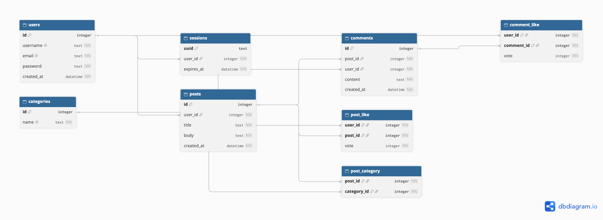

# 🦁 Literary Lions

Literary Lions is a web forum where users can discuss books, share their thoughts, and connect with other readers.

The project is built using **Go**, **SQLite**, and server-rendered HTML templates.

## Screenshots
## Database ERD



### Homepage


### Registration


### Login


### Post Details


## Features

- User registration and login
- Create, view, and delete posts
- Comment on discussions
- Like and dislike posts
- Search posts by title or content
- Filter posts by category
- View posts created by a specific user
- View liked posts
- Custom error pages

## Technologies Used

- **Go** — Backend server and HTTP handlers
- **SQLite** — Database
- **HTML/CSS** — Frontend and page styling
- **Go templates** — Server-side HTML rendering
- **Docker** — Containerized application deployment

## Project Structure

```text
forum/
├── cmd/
│   └── forum/          # Application entry point
├── internal/
│   ├── api/            # API-related code
│   ├── database/       # Database initialization
│   ├── handler/        # HTTP handlers and routes
│   ├── middleware/     # Authentication and middleware
│   ├── model/          # Data models
│   ├── repository/     # Database queries
│   └── service/        # Business logic
├── static/             # CSS and other static assets
├── templates/          # HTML templates
├── screenshots/        # Application screenshots
├── Dockerfile
├── Makefile
└── README.md
```

## Getting Started

### Requirements

For running the application locally:

- Go
- Git
- Make (optional)

For running the application with Docker:

- Docker
- Make (optional)

### Installation

Clone the repository and enter the project directory:

```bash
git clone https://github.com/Fathkrc/forum.git
cd forum
```

Download the Go dependencies:

```bash
go mod download
```

### Running the Application

Start the server using Make:

```bash
make run
```

Alternatively, run it directly with Go:

```bash
go run ./cmd/forum
```

Once the server starts, open:

http://localhost:8080

## Running with Docker

Literary Lions can also be built and run using Docker.

### Build the Docker Image

From the project root, run:

```bash
make docker-build
```

Alternatively, without Make:

```bash
docker build -t literary-lions:1.0.0 .
```

This builds the Docker image using the project's Dockerfile.

### Run the Docker Container

To start the application in the terminal:

```bash
make docker-run
```

Alternatively, to run the container in the background:

```bash
make docker-start
```

Once the application starts, open:

http://localhost:8080

### Stop the Container

To stop the running container:

```bash
make docker-stop
```

You can also press `Ctrl+C` if you started the application using `make docker-run`.

### View Container Logs

To view the application's logs:

```bash
make docker-logs
```

### Check Container Status

To list containers, including stopped ones:

```bash
make docker-status
```

### Clean Up Docker Resources

Remove the container:

```bash
make docker-clean
```

Remove the Docker image:

```bash
make docker-image-clean
```

**Note:** The current Docker configuration does not explicitly set up persistent SQLite storage. Database data stored inside the container may be lost when the container is removed.

## Makefile Commands

The project includes a Makefile to simplify development, testing, building, and running the application with Docker.

| Command | Description |
|---|---|
| `make run` | Start the application locally |
| `make test` | Run all Go tests |
| `make vet` | Check for common Go code issues |
| `make fmt` | Format Go source files |
| `make check-format` | Verify Go formatting without changing files |
| `make build` | Compile the application into `bin/forum` |
| `make check` | Run formatting checks, vetting, tests, and build |
| `make docker-build` | Build the Docker image |
| `make docker-run` | Run the Docker container in the terminal |
| `make docker-start` | Start the Docker container in the background |
| `make docker-stop` | Stop the running container |
| `make docker-logs` | View container logs |
| `make docker-status` | List Docker containers |
| `make docker-clean` | Remove the Docker container |
| `make docker-image-clean` | Remove the Docker image |

## Testing

Run the test suite:

```bash
make test
```

To run tests without using cached results:

```bash
go test -count=1 ./...
```

## Running All Checks

Before committing or pushing changes, run:

```bash
make check
```

This verifies formatting, runs `go vet`, executes the tests, and builds the application.

## Building the Application

Compile the server:

```bash
make build
```

The executable will be created at:

```text
bin/forum
```

## About the Project

Literary Lions was developed as a group project to practice building a web application using Go.

The project focuses on HTTP routing, authentication, database operations, server-side rendering, testing, and containerization.
