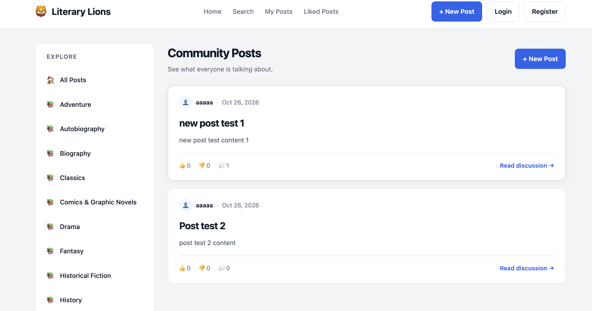
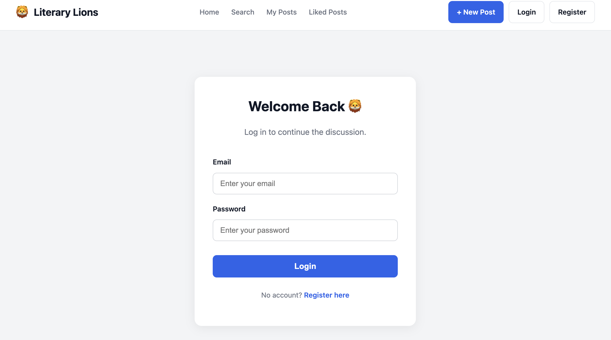
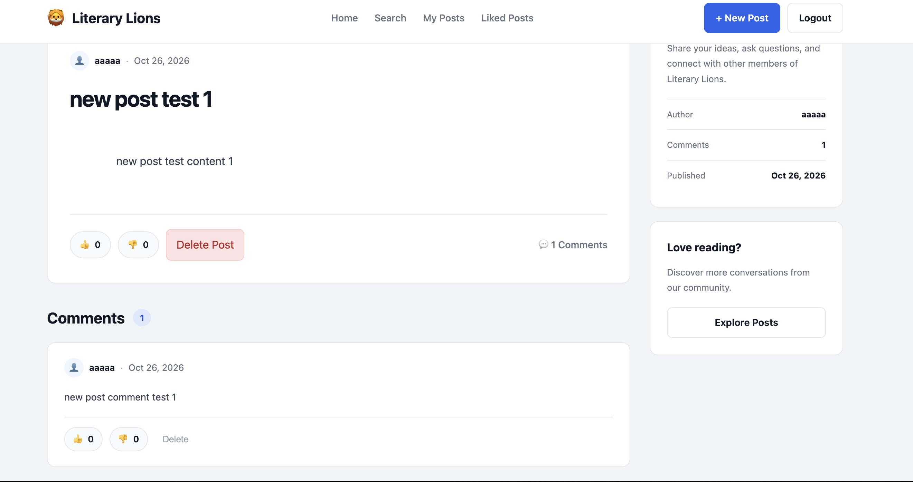

# 🦁 Literary Lions

Literary Lions is a web forum where users can discuss books, share their thoughts, and connect with other readers.

The project is built using **Go**, **SQLite**, and server-rendered HTML templates.

## Features
Screenshots










- User registration and login
- Create, view, and delete posts
- Comment on discussions
- Like and dislike posts
- Search posts by title or content
- Filter posts by category
- View posts created by a specific user
- View liked posts
- Custom error pages

## Technologies Used

- **Go** — Backend server and HTTP handlers
- **SQLite** — Database
- **HTML/CSS** — Frontend and page styling
- **Go templates** — Server-side HTML rendering
- **Docker** — Container setup (in progress)

## Project Structure

```text
forum/
├── cmd/
│   └── forum/          # Application entry point
├── internal/
│   ├── api/            # API-related code
│   ├── database/       # Database initialization
│   ├── handler/        # HTTP handlers and routes
│   ├── middleware/     # Authentication and middleware
│   ├── model/          # Data models
│   ├── repository/     # Database queries
│   └── service/        # Business logic
├── templates/          # HTML templates
├── Makefile
└── README.md
```

Getting Started

Requirements

Go

Git

Installation

Clone the repository and enter the project directory:

git clone <repository-url>
cd forum

Download the Go dependencies:

go mod download

Running the Application

Start the server using Make:

make run

Alternatively, run it directly with Go:

go run ./cmd/forum

Once the server starts, open:

http://localhost:8080

Makefile Commands

The project includes a Makefile to simplify development, testing, and building.

Command

Description

make run

Start the application

make test

Run all Go tests

make vet

Check for common Go code issues

make fmt

Format Go source files

make check-format

Verify Go formatting without changing files

make build

Compile the application into bin/forum

make check

Run formatting checks, vetting, tests, and build

Testing

Run the test suite:

make test

To run tests without using cached results:

go test -count=1 ./...

Running All Checks

Before committing or pushing changes, run:

make check

This verifies formatting, runs go vet, executes the tests, and builds the application.

Building the Application

Compile the server:

make build

The executable will be created at:

bin/forum

## Docker

Docker support is being finalized. Setup instructions will be added once the configuration is complete.

## About the Project

Literary Lions was developed as a group project to practice building a web application using Go.

The project focuses on HTTP routing, authentication, database operations, server-side rendering, and testing.
